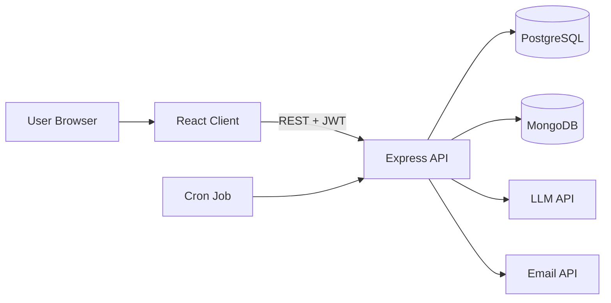

# High-Level Design: Time Capsule

## 1. Architecture Overview
A three-tier web app with a React SPA, an Express REST API, two databases, and external services for AI and email.

## 2. Components
| Component | Responsibility |
|-----------|----------------|
| React Client | UI, routing, forms, validation, API calls |
| Express API | Auth, capsule CRUD, validation, business rules, error handling |
| Auth Middleware | Verifies JWT, attaches user, checks role |
| PostgreSQL | Users, capsule metadata, tags (relational data) |
| MongoDB | Letter content, attachments, LLM analysis (flexible documents) |
| Cron Job | Hourly check for capsules due to unlock |
| LLM Service | Analyses letter text, returns structured JSON |
| Email Service | Sends the unlock notification |

## 3. Why Two Databases
- **PostgreSQL** for data with clear relations and constraints (user → capsules → tags), and for queries with JOINs and filtering by date.
- **MongoDB** for letter bodies and AI analysis, which are document-shaped and may change as the analysis output evolves.
- Link: `capsules.mongo_letter_id` in Postgres points to the `_id` of the Mongo letter document.

## 4. Key Flows

### 4.1 Create Capsule
1. Client validates the form and sends `POST /api/capsules` with the JWT.
2. Auth middleware verifies the token.
3. The server validates the body (title, content, `unlock_at` in the future).
4. The letter is saved to MongoDB, then the metadata row is saved to Postgres.
5. If the Postgres insert fails, the Mongo document is deleted (compensating action).
6. The server returns `201` with the capsule metadata, without content.

### 4.2 Read Capsule
1. `GET /api/capsules/:id` checks ownership.
2. If `unlock_at` is in the future, return `403` and no content.
3. Otherwise fetch the letter and analysis from Mongo and return them.

### 4.3 Unlock Job (hourly)
1. Query Postgres for capsules with `status = 'locked'` and `unlock_at <= now()`.
2. For each one, fetch the letter from Mongo and call the LLM.
3. Validate the JSON output, store the analysis in Mongo, and set `status = 'unlocked'` in Postgres.
4. Send the email and record the result.
5. On LLM failure, retry, then unlock without analysis.

## 5. API Surface (summary)
| Method | Endpoint | Purpose |
|--------|----------|---------|
| POST | /api/auth/register | Create account |
| POST | /api/auth/login | Get JWT |
| GET | /api/capsules | List my capsules |
| POST | /api/capsules | Create capsule |
| GET | /api/capsules/:id | Read capsule (if unlocked) |
| PUT | /api/capsules/:id | Edit (if locked) |
| DELETE | /api/capsules/:id | Delete |
| GET | /api/admin/stats | Admin stats |

## 6. Security
- Passwords hashed with bcrypt.
- JWT in the `Authorization` header.
- Role checks for admin routes.
- Input validation and sanitization on every endpoint.
- Rate limiting on auth and creation routes.
- Secrets only in `.env`, never committed.
- Letter text is passed to the LLM as data, with output schema validation.

## 7. Scalability and Failure Handling
- Stateless API, so it can scale horizontally.
- Indexes on `capsules(user_id)` and `capsules(status, unlock_at)`.
- Cron queries are idempotent: missed runs are caught next time.
- LLM and email calls are wrapped with retries and timeouts.
- If the user count grows: move the cron to a queue (e.g. BullMQ) and cache reads with Redis.

## 8. Deployment
- Frontend: Vercel or Netlify
- Backend: Render or Railway
- Postgres: Neon or Supabase
- MongoDB: Atlas free tier